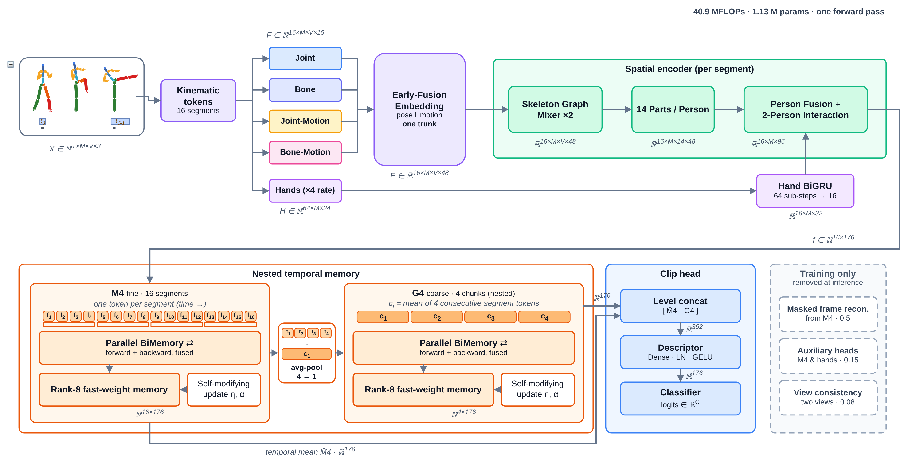

<h1 align="center">NestSAR</h1>

<p align="center">
  <strong>Ultra-Low-Compute Skeleton-Based Action Recognition</strong><br>
  JAX · NTU RGB+D 60 / 120 · NW-UCLA · 40.9 MFLOPs per clip · measured on a Raspberry Pi Zero 2 W
</p>

<p align="center">
  
  
  
  
  
  
</p>

NestSAR recognises human actions from 3D skeletons at **40.9 MFLOPs per clip** (strict count, 2 × MACs) with
**1.13 M inference parameters**. It uses no softmax attention, no Transformer and no T×T operation; space is mixed
by a two-layer graph encoder, time by recurrent memory. A variable-length clip is summarised into 16
motion-preserving temporal tokens, and the whole network runs on those 16.

<p align="center"></p>

**Architecture** (`experiments/nestsar_r5_t16/model.py`, variant `graph_mr`):

- **One early-fused trunk.** Joint, bone, joint-motion and bone-motion features are fused per joint; there are no four
  separate stream models.
- **Spatial graph encoder.** Two graph-aggregation layers over the 25 joints of each frame (normalised skeleton
  adjacency plus a learned residual adjacency, zero-initialised), then pooling into 14 body parts.
- **Hand branch.** Hand-relative tokens at 4× the temporal rate (tip, thumb, hand, wrist) go through a bidirectional
  GRU and are pooled back to 16 steps.
- **Person interaction.** Explicit person-person geometry plus a layer-scaled cross-person message.
- **Nested temporal memory.** A BiGRU over the 16 segments (M4), the same over 4 chunks (G4), and a surprise-gated,
  self-modifying fast memory at each level.
- **Training only.** A masked-reconstruction head (mask ratio 0.5), absent from the inference graph.

## Results

All values are top-1 accuracy (%), mean ± std over 3 seeds (7, 11, 23), one pass per clip, 60 epochs on NTU and
80 epochs max on NW-UCLA.

| Benchmark | Protocol | NestSAR |
| --- | --- | ---: |
| NTU RGB+D 60 | X-Sub | **85.55 ± 0.14** |
| NTU RGB+D 60 | X-View (±45° view augmentation) | **91.89 ± 0.11** |
| NTU RGB+D 120 | X-Sub | **78.54 ± 0.09** |
| NTU RGB+D 120 | X-Set | **80.35 ± 0.12** |
| Northwestern-UCLA | cross-view (train views 1+2, test view 3) | **90.09 ± 0.94** |

### Equal-cost control: SGN scaled to the same budget

SGN-40 is **our** scaled SGN (width × 0.3125, 39.9 MFLOPs), built to answer *"what if you simply shrink an existing
model?"*. SGN full is our reimplementation of SGN at its published width (359 MFLOPs per pass; its paper reports 89.0
on NTU-60 X-Sub with 5-crop testing, our reimplementation gives 88.53).

| Benchmark | NestSAR (40.9 MFLOPs) | SGN-40 (39.9 MFLOPs) | Δ at equal cost |
| --- | ---: | ---: | ---: |
| NTU-60 X-Sub | **85.55** | 83.22 | **+2.3** |
| NTU-60 X-View | **91.89** | 88.35 | **+3.5** |
| NTU-120 X-Sub | **78.54** | 72.07 | **+6.5** |
| NTU-120 X-Set | **80.35** | 74.30 | **+6.1** |
| NW-UCLA | **90.09 ± 0.94** | 85.63 ± 2.71 | **+4.5** |

On NW-UCLA, NestSAR (90.09) also beats SGN full at 9× the compute (88.94 ± 0.97) and SGN full with 5-crop testing at
44× the compute (89.66 ± 0.99).

### Ablation (NTU-60 X-Sub, 38 epochs, 3 seeds)

| Variant | Temporal module | MFLOPs | Top-1 |
| --- | --- | ---: | ---: |
| **NestSAR** | nested M4/G4 memory + fast memory | 40.9 | **84.94** |
| FLATSTACK | stacked flat levels | 51.1 | 84.93 |
| NOFAST | nested, no fast memory | 40.5 | 84.65 |
| FLAT | single level | 37.2 | 84.55 |
| FLATNOFAST | single level, no fast memory | 37.0 | 84.39 |
| TATTN | temporal attention | 43.4 | 84.30 |
| TCONV | 2 × depthwise temporal conv | 31.2 | 83.39 |
| NOTEMP | none (order-free per-segment MLP) | 27.1 | 81.87 |

Temporal memory gives +3.1 over none and +1.6 over a temporal convolution. Nesting gives +0.4 over a single flat level
(at +3.7 MFLOPs), matches stacking flat levels with 20 % fewer FLOPs, and gives +0.6 over temporal attention at lower
cost. A larger variant (ST2, 56.5 MFLOPs) adds about +0.3 on
every protocol; it is not the reported model.

## Edge deployment

For **CUDA on Jetson Nano 2/4 GB or Orin Nano Super**, run `./jetson.sh`.
The launcher chooses the matching JetPack image, builds TensorRT engines on the
device and checks GPU outputs before benchmarking. See
[`deploy/jetson/README.md`](deploy/jetson/README.md) for supported JetPack versions,
trained checkpoints and the distinction between latency and action prediction.

Every model is exported to ONNX Runtime and to XLA (`jax.export`, weights baked in). Each is reported with its **best**
runtime and thread setting, batch 1.

| Model | MFLOPs | Raspberry Pi Zero 2 W (ms) | x86 test machine (ms) | NTU-60 X-Sub |
| --- | ---: | ---: | ---: | ---: |
| SGN-40 (ours, equal cost) | 39.9 | 15.96 | 0.91 | 83.22 |
| Two-Stream CNN | 165.1 | 30.12 | 0.91 | 83.89 |
| **NestSAR (edge schedule)** | **40.9** | **35.03** | **1.94** ¹ | **85.55** |
| HCN-B | 387.9 | 65.80 | 3.35 | 87.67 |
| SGN full | 359.3 | 66.60 | 3.28 | 87.43 |
| Ta-CNN | 289.0 | 86.47 | 4.82 | 88.53 |
| CTR-GCN | 3878.4 | 1215.62 | 49 | — |

¹ The x86 figure is the training schedule; on x86 the edge schedule makes no difference (1.40 vs 1.42 ms on one thread).

- **NestSAR is on the latency-accuracy Pareto front, not the fastest model.** SGN-40 is 2.2× faster on the Pi, and
  NestSAR is +2.3 to +6.5 points more accurate.
- **Edge schedule.** The training code advances both GRU directions in one scan, so each step reads 743 KB of recurrent
  weights, more than the Pi's 512 KB L2. Running the forward and backward scans one after the other
  (`experiments/edge/edge_schedules.py`) cuts the Pi latency from 48.0 to **35.0 ms (−27 %)** with the same weights.
  Over the full NTU-60 test sets (5 final runs, 89,770 clips) it changes **0 predictions** (max |Δlogit| ≈ 3·10⁻⁶).
- **On-device accuracy.** The exported program, with trained weights, run clip by clip on the Pi over all 16,487
  NTU-60 X-Sub test clips: **85.70 %**, identical to the GPU evaluation of the same weights (seed 23). End to end,
  including reading each clip from the SD card, it takes 43.3 ms per clip.

The ready-to-run edge kit (models, installer, benchmarks) is on the
[`edge-kit`](https://github.com/rombaldivia/NestSAR/tree/edge-kit) branch.

## Reproduce

Training runs on Kaggle with 2 × T4. The default dataset is NTU-120; set `NESTSAR_DATASET=ntu60` or `nwucla`.

```python
!git clone -q https://github.com/rombaldivia/NestSAR.git /kaggle/working/NestSAR
import json, subprocess
recipe = {"aug_strength": 1.0, "dropout": 0.3, "weight_decay": 0.05, "label_smoothing": 0.1, "recon_mask_ratio": 0.5}
jobs = [{"name": f"NestSAR_NTU60_T16_XSUB_SEED{s}", "dataset": "ntu60", "protocol": "xsub", "variant": "graph_mr",
         "epochs": 60, "view_degrees": 15, "pool": "/tmp/NestSAR_AUGPOOL_T16_NTU60", "extra": dict(recipe, seed=s)}
        for s in (7, 11, 23)]
json.dump(jobs, open("/kaggle/working/jobs.json", "w"))
subprocess.Popen("cd /kaggle/working/NestSAR && python -u -m experiments.nestsar_r5_t16.kaggle_queue "
                 "--jobs /kaggle/working/jobs.json > /kaggle/working/queue.log 2>&1", shell=True, start_new_session=True)
```

- **NTU-60 X-View** uses `"view_degrees": 45`. **NTU-120** uses `"dataset": "ntu120"` with protocols `xsub` / `xset`.
- **NW-UCLA.** First convert the standard `all_sqe` release (see the CTR-GCN README):
  `python -m experiments.nestsar_r5_t16.prepare_nwucla --src all_sqe --out nwucla_3danno.pkl`. Then run jobs with
  `"dataset": "nwucla"`, `"protocol": "xview"`, `"epochs": 80`, `"view_degrees": 45`, `"pickle": "…/nwucla_3danno.pkl"`
  and, in `extra`, `"micro_batch": 16, "accumulation_steps": 1, "eval_batch": 64, "learning_rate": 2e-4, "patience": 20`.
- **SGN baselines:** `python -m experiments.sgn_baseline.train_sgn --pickle … --split xsub --width 0.3125` (or 1.0).
  For NW-UCLA, convert with `--fill-hands`, because SGN has no missing-joint mask.
- **Edge:** `experiments/edge/` holds the exporters (`export_onnx.py`, `export_xla.py`, `export_baselines.py`), the
  benchmarks, `eval_schedule.py` (edge vs training schedule over a full test split), and `make_pi_eval.py` /
  `eval_pi.py` (on-device accuracy).

## Notes

- **The ± values** are the standard deviation over 3 seeds.
- **NW-UCLA, like the other benchmarks,** reports the best epoch on the evaluation split, as is standard for these
  benchmarks.
- **NW-UCLA joints.** NW-UCLA (Kinect v1) has no hand tip or thumb joints. NestSAR masks them as missing; for SGN they
  are filled with the hand joint, which favours the baseline.
- **Baseline numbers.** Two-Stream CNN, HCN-B, Ta-CNN and CTR-GCN accuracies are the published ones; their latencies
  are measured here with ports of the public code (`experiments/edge/skelact_models.py`, Apache-2.0).
- **History.** Earlier research lines and their ledgers (`NESTSAR_EXPERIMENT_STATUS_*.md`, `nestsar.py`) are kept for
  reference; the current model lives in `experiments/nestsar_r5_t16/`.
